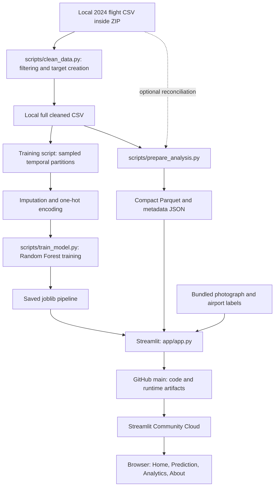

# Aviation Signature — Flight Delay Prediction System

A Python and Streamlit application for estimating departure-delay risk and exploring historical US flight patterns.

- **Website:** [Aviation Signature](https://meerah-flight-delay-prediction.streamlit.app/)
- **Repository:** [Flight_Delay_Prediction](https://github.com/meraahhh/Flight_Delay_Prediction)

## 1. Project Overview

The system uses a saved Random Forest model to estimate whether a departure will be **at least 15 minutes late**, given scheduled flight details. A separate dashboard analyzes the full cleaned 2024 dataset.

The binary target is `delayed = int(dep_delay >= 15)`, where `dep_delay` is departure delay in minutes. Class `1` means delayed; class `0` includes early departures and departures less than 15 minutes late. Consequently, the application's **On Time** label does not mean exactly on schedule.

Predictions are estimates based on historical data, **not live flight status**. The application does not train models or retrieve live flight information.

## 2. Project Architecture



- **Offline scripts** reproduce cleaning and the final Random Forest training workflow. The original notebooks retain exploration and experiment history.
- **Analysis preparation** validates and aggregates the full cleaned data independently of model training.
- **The application** loads the saved pipeline and compact analytics artifacts. It calculates filtered dashboard statistics at runtime.
- **Deployment** needs the tracked runtime artifacts, not the large original datasets or notebook execution.

Cleaning and final Random Forest training have standalone commands; obtaining the original dataset remains manual. See [Reproducing the Workflow](#11-reproducing-the-workflow) for prerequisites and gaps.

## 3. Repository Structure

The tracked project structure is:

```text
Flight_Delay_Prediction/
├── .gitignore
├── .streamlit/
│   └── config.toml
├── README.md
├── requirements.txt
├── app/
│   ├── app.py
│   ├── airport_labels.py
│   └── dashboard_data.py
├── assets/
│   ├── ATTRIBUTION.md
│   ├── airport_names.json
│   └── aviation-hero.jpg
├── data/
│   └── analysis/
│       ├── flight_analysis_2024.metadata.json
│       └── flight_analysis_2024.parquet
├── models/
│   └── flight_delay_rf_model_updated.pkl
├── notebooks/
│   ├── 01_data_understanding.ipynb
│   └── 02_full_data_analysis.ipynb
├── scripts/
│   ├── clean_data.py
│   ├── prepare_analysis.py
│   └── train_model.py
└── tests/
    ├── test_clean_data.py
    ├── test_dashboard.py
    ├── test_train_model.py
    ├── browser_helpers.cjs
    ├── browser_header.cjs
    ├── browser_analysis.cjs
    ├── browser_website.cjs
    └── browser_quality.cjs
```

| Component | Responsibility |
|---|---|
| `app/app.py` | Four-page navigation, booking-style prediction form, charts, downloads, and interface styling |
| `app/dashboard_data.py` | Filtering, summed aggregation, weighted rates, and totals |
| `app/airport_labels.py` | Airport display-name lookup with code-only fallback |
| `scripts/clean_data.py` | Standalone notebook-equivalent cleaning with explicit paths, count/missing-value reporting, and overwrite protection |
| `scripts/train_model.py` | Independent final Random Forest training with protected outputs and a split/evaluation report |
| `scripts/prepare_analysis.py` | Chunked validation, full-data aggregation, Parquet generation, metadata, and optional raw-ZIP reconciliation |
| `models/flight_delay_rf_model_updated.pkl` | Deployed fitted preprocessing and Random Forest pipeline |
| `notebooks/01_data_understanding.ipynb` | Exploration of a 10,000-row sample |
| `notebooks/02_full_data_analysis.ipynb` | Full-data inspection and cleaning, sampled experiments, final temporal evaluation, and model saving |
| `data/analysis/` | Packaged full-data analytics and its provenance/validation metadata |
| `.streamlit/config.toml` | Light theme using navy, burgundy, and ivory; not Cloud account configuration |
| `tests/` | Python data/application checks and separate Playwright browser regressions |
| `assets/` | Locally bundled interface resources; no remote image request is required |

Photo attribution and licensing are recorded in [assets/ATTRIBUTION.md](assets/ATTRIBUTION.md). Airport display references record their provenance in `airport_names.json`. These asset licenses do not cover the flight dataset or project code.

## 4. Dataset

### Scope and provenance

The repository identifies the input as **US flight data for calendar year 2024**, covering January 1 through December 31. The local source ZIP is named `flight_data_2024.csv.zip` and contains `flight_data_2024.csv`.

**The notebooks and dataset metadata do not record an upstream provider, download URL, or flight-data license.** Confirm the original source and usage rights before distributing the input data. Rebuilding requires obtaining that input manually; running the packaged application does not.

### Verified full-data totals

These reference values come from [the committed metadata](data/analysis/flight_analysis_2024.metadata.json), including raw-ZIP reconciliation. They are not the training-sample counts.

| Measure | Count |
|---|---:|
| Original flight records | 7,079,081 |
| Cancelled flights | 96,315 |
| Records with missing departure delay | 92,970 |
| Records excluded by the combined eligibility rule | 96,315 |
| Cleaned eligible records | 6,982,766 |
| Delayed: class `1` | 1,441,139 (20.6385%) |
| Not delayed: class `0` | 5,541,627 (79.3615%) |

Cancelled and missing-delay counts **overlap** and must not be added. Diverted flights are retained. The full cleaned data contains 15 carrier codes and 348 distinct airports in each of the origin and destination columns. Prediction choices instead come from categories learned by the saved model; they need not cover every full-data airport.

### Prediction features

| Model column | Meaning and application encoding |
|---|---|
| `month` | Scheduled date's month, 1–12 |
| `day_of_month` | Scheduled date's day |
| `day_of_week` | Monday = 1, Tuesday = 2, …, Sunday = 7 |
| `op_unique_carrier` | Operating carrier code |
| `origin` | Departure airport IATA code |
| `dest` | Destination airport IATA code |
| `crs_dep_time` | Local scheduled departure time as integer HHMM, e.g. 1430; not minutes since midnight |
| `distance` | Flight distance in miles, entered by the user |

The form collects six inputs; its date produces three calendar features. Airport names are shown alongside codes where available, while the model receives the original codes.

### Large files excluded from Git

`.gitignore` excludes direct `data/*.csv` and `data/*.zip` files. Local files include:

- `data/flight_data_2024.csv.zip`: original input.
- `data/flight_data_cleaned.csv`: full eligible dataset, 1,309,555,273 bytes.
- `data/flight_data_2024_sample.csv`: exploration sample.
- `data/flight_data_2024_data_dictionary.csv`: local column reference.

These are not supplied by a fresh clone. The previous `models/flight_delay_rf_model.pkl` is also ignored; the deployed **updated** artifact is tracked. Files nested in `data/analysis/` are tracked.

### Packaged analysis schema

The Snappy-compressed Parquet contains **2,172,103 grouped rows**, occupying **9,552,946 bytes** (about 9.55 MB). A row represents a combination of six dimensions, not one flight:

| Type | Columns |
|---|---|
| Dimensions | `month`, `op_unique_carrier`, `origin`, `dest`, `day_of_week`, `departure_hour` |
| Additive measures | `flights`, `delayed_flights`, `departure_delay_minutes_sum`, `delayed_departure_minutes_sum` |

Metadata records source/artifact SHA-256 hashes, sizes, cleaning rules, date range, weekday mapping, totals, monthly counts, and optional original-source reconciliation. This supports exact summed statistics for the available filter dimensions without deploying the original CSV.

## 5. Data Cleaning

`scripts/clean_data.py` reproduces the filtering and target creation in `notebooks/02_full_data_analysis.ipynb`. The original notebook implements the following workflow (cell numbers below are **zero-based**, matching the notebook's JSON order):

1. **Inspect the original ZIP** in cells 0–3: count rows, inspect missing values, count cancellations/diversions, and calculate eligible records.
2. **Read in 100,000-row chunks** in cell 4, specifying a string dtype for `cancellation_code`.
3. **Keep only** `(cancelled == 0) & dep_delay.notna()`.
4. **Create** `delayed = (dep_delay >= 15).astype(int)`.
5. **Write the retained original columns plus the target** to `data/flight_data_cleaned.csv`, appending chunks with one header.
6. **Inspect remaining missing values and target counts** in cells 5–7. Missing values in unrelated columns are not globally dropped or filled by this cleaning step.

Cell 4 deletes an existing cleaned output before rebuilding it. Use a fresh output location or preserve an existing file before running that cell.

The implementation does **not** establish full-dataset deduplication, outlier clipping, removal of negative delays, or comprehensive invalid-value repair. The sample notebook checks duplicates only in its sample; that is not proof that the full dataset is duplicate-free. Negative delays represent early departures and remain in analytics sums.

### Standalone cleaning command

From the repository root, with dependencies installed:

```bash
python scripts/clean_data.py --input data/flight_data_2024.csv.zip --output data/flight_data_cleaned_rebuilt.csv --expected-input-rows 7079081 --expected-output-rows 6982766
```

This writes a **new** CSV; it does not overwrite `data/flight_data_cleaned.csv` or any existing destination. The output parent directory must already exist. Use another unused output filename for another run. No application path or deployed artifact is changed.

`--input` accepts a plain CSV or ZIP. ZIP input defaults to member `flight_data_2024.csv`; use `--zip-member` for another member. `--output` is required. Relative paths are resolved from the current working directory. `--chunksize` defaults to the notebook's 100,000 rows. The optional expected-count flags above validate the known original dataset; omit or change them only for deliberately different inputs. Run `python scripts/clean_data.py --help` for options.

Only `cancelled` and `dep_delay` are required for the cleaning operation. Missing eligibility values are handled by the original predicate: missing cancellation flags do not match zero; missing departure delays are excluded. Nonnumeric eligibility values raise an error rather than being silently coerced. Other columns and missing values are preserved, with no deduplication, outlier removal, or new eligibility rules. If present, `delayed` is recomputed using the original target definition.

The JSON report printed to the terminal includes input, retained, excluded, cancelled, missing-delay, and target-class counts, plus per-column missing-value counts before and after filtering. Cancelled and missing-delay counts can overlap. Count mismatches or processing errors fail the command and remove its partial output. Missing source columns, invalid numeric values, and existing output files also fail explicitly. CSV formatting can vary with pandas chunk type inference, just as in the notebook; source row order and retained values are preserved.

Synthetic regression tests compare CSV and ZIP output with the notebook's chunked operations, including the 15-minute boundary, negative delays, diversions, duplicates, missing values, invalid inputs, count checks, and overwrite protection:

```bash
python -B -m unittest discover -s tests -p test_clean_data.py -v
```

### Additional analytics validation

`scripts/prepare_analysis.py` validates rather than silently repairs the cleaned input:

- Required analysis columns must be present and non-missing.
- Eligibility and target values must match the cleaning rules.
- Dates must be in 2024; year, month, day, and Monday-based weekday must agree.
- Scheduled HHMM values must be valid integers with valid minutes. `2400` is grouped into hour `0` on the recorded date; the date is not advanced.
- Summed aggregates must reconcile with source totals; the written Parquet must survive a read-back comparison.
- With `--original-zip`, counts and departure-delay sums are reconciled by month against independently filtered raw records. This verifies aggregates, not exact row identity.

The script does not deduplicate data, alter source files, or load/train a model.

## 6. Data Preprocessing

The deployed joblib artifact includes its fitted preprocessing, so callers supply the eight original feature columns rather than manually encoded arrays.

- **Categorical columns:** `op_unique_carrier`, `origin`, `dest`; most-frequent imputation, followed by `OneHotEncoder(handle_unknown="ignore")`.
- **Numerical columns:** calendar fields, scheduled HHMM, and distance; median imputation.
- **Scaling:** none in the deployed Random Forest. A separate logistic-regression experiment uses scaling; it is not the deployed pipeline.

### Splits used for the final saved model

The final workflow in notebook 02 samples **6% from each temporal partition within each 100,000-row chunk**, using `random_state=42`:

| Partition | Period / method | Records |
|---|---|---:|
| Earlier-period sample | January–September 2024 | 312,861 |
| Final training | 80% of that sample | 250,288 |
| Validation | 20% of that sample | 62,573 |
| Final test | October–December 2024 sample | 106,105 |

The training/validation split is stratified by target with `test_size=0.2`, `random_state=42`. The October–December sample is kept separate from final fitting. Earlier notebook experiments use a different 3% sample and random 80/20 split; those are not the final model's evaluation split.

### Leakage safeguards and limits

The final features use scheduled/calendar information, not observed departure delay, arrival outcomes, or the target. Preprocessing is fitted with the training pipeline; later-period flights are not part of final Random Forest fitting.

This is not evidence of a completely untouched evaluation process: the exploratory notebook compares thresholds/models using held-out results, and its HGB comparison reuses the Random Forest preprocessing object. A stricter experiment would isolate preprocessing objects and reserve an untouched evaluation set. The repository does not establish route/flight-group isolation across partitions. Do not claim a complete leakage audit.

## 7. Machine Learning Model

**Algorithm:** `sklearn.ensemble.RandomForestClassifier`, an ensemble of decision trees whose outputs are combined to estimate class probabilities.

**Artifact:** `models/flight_delay_rf_model_updated.pkl`, loaded using `joblib`. It is a scikit-learn `Pipeline` with `preprocessing` and `classifier` steps, approximately 15.42 MiB.

Verified saved classifier configuration:

| Parameter | Value |
|---|---|
| `n_estimators` | `150` |
| `max_depth` | `25` |
| `min_samples_leaf` | `10` |
| `class_weight` | `"balanced"` |
| `random_state` | `42` |
| `n_jobs` | `-1` |

Notebook 02 also contains logistic-regression, earlier Random Forest, and balanced HistGradientBoosting experiments. These are not additional models served by the application.

### Verified evaluation

Notebook 02 cell 48 reports the following final Random Forest results on **106,105 October–December 2024 sampled flights**. The About page displays the same rounded metrics.

| Metric | Result |
|---|---:|
| Accuracy | 72.56% |
| Precision, delayed class | 27.04% |
| Recall, delayed class | 37.89% |
| F1-score, delayed class | 31.56% |

Confusion matrix: rows are actual classes; columns are predicted classes.

| Actual / Predicted | Not delayed (`0`) | Delayed (`1`) |
|---|---:|---:|
| Not delayed (`0`) | 70,280 | 18,110 |
| Delayed (`1`) | 11,002 | 6,713 |

These are saved notebook evaluation results, not a fresh evaluation on every application startup. Tests verify that the displayed percentages agree with this matrix. The test records themselves are not committed as a separate dataset.

### Application decision rules

The application uses the class-1 value from `model.predict_proba(...)`:

- Predicted **Delayed** when probability is **≥ 0.50**; otherwise **On Time**.
- **Low** risk: probability < 0.40.
- **Moderate** risk: 0.40 ≤ probability < 0.70.
- **High** risk: probability ≥ 0.70.

Risk bands and the classification cutoff serve different purposes: a Moderate-risk flight can still be classified On Time. No probability-calibration stage is present; the displayed value is a model estimate, not a guaranteed frequency.

## 8. Application Features

### Home

Bundled airplane photograph, concise introduction, and functional **Predict Flight** / **View Analytics** buttons. Horizontal navigation connects all four pages. The Aviation Signature interface uses navy, burgundy, ivory, white, and champagne-gold accents with responsive layouts.

### Flight Prediction

Booking-style form for departure/destination airports, date, airline, local scheduled departure time, and distance. Airport/carrier choices come from the model encoder. Available airport names are display-only. The form rejects identical origin/destination airports and restricts distance to at least one mile; it does not validate route existence or calculate distance.

Results show **Predicted Status**, **Delay Probability**, and **Risk Level**, with a visible historical-data/non-live-status note.

### Flight Analytics

Four visible KPIs: flight count, delayed count, delay rate, and average departure delay. Filters cover month, airline, departure/destination airport, weekday, and inclusive local scheduled-hour range. Filter selections persist across navigation. Remove **All** to choose individual values; clearing a selection deliberately produces no matches. Reset restores defaults.

Four collapsible groups start closed:

| Group | Contents |
|---|---|
| Monthly & Time Analysis | Monthly delay chart, departure-hour chart, weekday chart, weekday × hour heatmap |
| Airline Performance | Airline delay comparison |
| Airport Performance | Departure and destination comparisons, up to 15 airports per ranking |
| Detailed Data | Calculated insights, summary table, data notes, CSV summary and JSON metadata downloads |

All **seven charts** retain tooltips and readable scales. Summary tables can group by any of the six dimensions. The minimum-flight control defaults to **100**, applying to rankings, heatmap cells, and insight comparisons; trend charts retain all available groups. Blank heatmap cells mean unavailable/below-threshold data, not zero delay.

Calculations after filtering use additive measures:

```text
delay rate = sum(delayed_flights) / sum(flights)
average departure delay = sum(departure_delay_minutes_sum) / sum(flights)
average delayed departure = sum(delayed_departure_minutes_sum) / sum(delayed_flights)
```

Percentages are never averaged across groups. The overall average includes negative early departures. Empty selections show a clear message instead of dividing by zero. Metadata downloads describe the source artifact, while CSV summaries reflect the current filters and selected grouping.

### About

Compact **How It Works**, **Model Performance**, and **Data & Limitations** sections, including verified metrics and the historical-data disclaimer.

## 9. Installation and Setup

### Prerequisites

- Git and Python with `pip` and `venv`.
- **Python 3.11.9 is verified in the local environment.** The repository does not pin the Python interpreter or provide a supported-version matrix; use Python 3.11 to match the verified setup.
- Internet access for the initial clone and dependency installation.

`requirements.txt` pins Streamlit 1.67.0, pandas 3.1.1, NumPy 2.4.6, scikit-learn 1.9.1, joblib 1.6.0, PyArrow 26.0.1, and Altair 6.3.0. PyArrow reads Parquet; Altair builds charts. Keep the pinned environment when loading the saved scikit-learn artifact.

### macOS / Unix shell

```bash
git clone https://github.com/meraahhh/Flight_Delay_Prediction.git
cd Flight_Delay_Prediction
python3.11 -m venv .venv
source .venv/bin/activate
python -m pip install -r requirements.txt
python -m pip check
```

### Windows PowerShell

```powershell
git clone https://github.com/meraahhh/Flight_Delay_Prediction.git
cd Flight_Delay_Prediction
py -3.11 -m venv .venv
.\.venv\Scripts\Activate.ps1
python -m pip install -r requirements.txt
python -m pip check
```

If PowerShell blocks activation, use `.\.venv\Scripts\python.exe` instead of `python` in subsequent commands; activation is optional when calling the environment's interpreter directly. In Windows Command Prompt, activate with `.venv\Scripts\activate.bat`.

## 10. How to Run the Project

From the repository root, with the virtual environment active:

```bash
python -m streamlit run app/app.py
```

The expected default local address is **http://localhost:8501**. Use the address printed by Streamlit if its port or server configuration differs. Stop the server with `Ctrl+C`. The public review site remains [Aviation Signature](https://meerah-flight-delay-prediction.streamlit.app/).

### Runtime files

A normal clone already supplies:

- `app/app.py`, `app/dashboard_data.py`, and `app/airport_labels.py`.
- `models/flight_delay_rf_model_updated.pkl`.
- Both files in `data/analysis/`.
- `assets/aviation-hero.jpg`; retain `airport_names.json` for named airport labels and `ATTRIBUTION.md` for provenance.
- `requirements.txt` and `.streamlit/config.toml`.

**No data-preparation command is needed to run the committed application.** The original ZIP, cleaned CSV, notebooks, and old model are not runtime dependencies. Airport-name lookup has a code-only fallback; the photograph, model, and analytics artifacts should be bundled for the complete experience. No API credentials are used by the application.

### Optional: rebuild analytics

Only when the full cleaned CSV is available:

```bash
python scripts/prepare_analysis.py --help
python scripts/prepare_analysis.py
```

The default source is `data/flight_data_cleaned.csv`; the default output directory is `data/analysis`. To also reconcile against the original ZIP:

```bash
python scripts/prepare_analysis.py --original-zip data/flight_data_2024.csv.zip
```

For a separate build that leaves the committed artifacts untouched:

```bash
python scripts/prepare_analysis.py --source data/flight_data_cleaned.csv --output data/analysis_rebuild --original-zip data/flight_data_2024.csv.zip
```

The last command creates a new output directory; it is an optional example, not a tracked folder. Builds overwrite the two output artifacts in the selected directory. Omitting `--original-zip` omits raw-source reconciliation from the new metadata. The script never retrains or replaces a model.

## 11. Reproducing the Workflow

Running the supplied application needs only a clone and the runtime dependencies. Rebuilding the model additionally requires the full cleaned 2024 CSV. A complete standalone training run using the verified cleaned dataset reproduced the original test metrics and confusion matrix exactly; see Model Reproducibility Verification below.

1. **Install the runtime** using section 9. Training uses pandas, NumPy, scikit-learn, and joblib from the existing pinned `requirements.txt`; no additional training dependency is needed:

   ```bash
   python -m pip install -r requirements.txt
   ```

2. **Obtain the original input manually.** No upstream URL or download script is supplied. Check its provenance, license, and recorded source hash.
3. **Clean the data** using section 5's standalone command, producing the separate `data/flight_data_cleaned_rebuilt.csv`. Check its count report against metadata.
4. **Train to a new model path**, from the repository root:

   ```bash
   python scripts/train_model.py --input data/flight_data_cleaned_rebuilt.csv --output models/flight_delay_rf_model_rebuilt.pkl --report models/flight_delay_rf_model_rebuilt.metrics.json
   ```

   This is an offline training command, not part of application startup. It reads the full cleaned CSV but fits only the final sampled training split. Existing cleaned data can instead be selected with `--input data/flight_data_cleaned.csv`. **Do not run this command merely to launch the app.**
5. **Inspect the JSON report** and compare results with the notebook only after a complete run. Do not replace the deployed model automatically.
6. **Prepare analytics separately**, if needed, using `scripts/prepare_analysis.py --source data/flight_data_cleaned_rebuilt.csv --output data/analysis_rebuild`. Analytics still uses all eligible flights, independently of training samples.
7. **Run appropriate tests and launch Streamlit** using the committed deployed model as documented in section 10. Training outputs are not loaded by the application.

### Standalone training behavior

- `--input` and `--output` are required; the input is a cleaned CSV, not the original ZIP or compact analytics data. Relative paths are resolved from the current working directory.
- `--report` is optional; by default it uses the model output path with its suffix replaced by `.metrics.json`. Both output parent directories must already exist.
- The script refuses existing model/report outputs, protects the deployed model path, and requires source/model/report paths to be distinct. It writes model/report files exclusively and cleans up its newly created files if saving fails.
- Input must contain the eight features plus `fl_date`, `delayed`, `dep_delay`, and `cancelled`. Dates must be non-missing and in 2024; cancellation flags and departure delays must satisfy the existing cleaning rule; the target must match `int(dep_delay >= 15)`. Invalid input fails rather than being silently cleaned. Missing feature values remain handled by the original imputers.
- Sampling preserves notebook cell 27: 100,000-row chunks, separate pre/post-October partitions, `sample(frac=0.06, random_state=42)` per nonempty partition per chunk, concatenation in source order. The 80/20 earlier-period split is stratified, with seed 42. Sampling/partition constants and classifier settings are fixed, rather than exposed as alternative experiments.
- A fresh pipeline is fitted **only on the final training split**. Validation and October–December test data use its fitted transforms. There is no refit on validation/test, threshold tuning, feature scaling, or other-model training.
- The report includes source SHA-256, source/split sizes, class counts, features, sampling settings, full classifier parameters, package versions, and validation/test accuracy, precision, recall, F1, and a `[0, 1]` confusion matrix. Metrics are fractions from 0 to 1; matrix rows are actual and columns predicted.
- Evaluation uses `Pipeline.predict`, exactly as notebook cell 48. Scikit-learn resolves exact class-probability ties to class 0; the existing app uses class-1 probability **≥ 0.50**. The script does not alter either evaluation convention or the application's threshold/risk bands.

### Differences from the original notebook

The script constructs the verified preprocessing and Random Forest settings directly, replacing the notebook's clone of an ignored intermediate model. It excludes earlier 3% experiments, HGB comparisons, shared preprocessing objects, notebook state, and stale outputs. It adds validation, protected output paths, and a machine-readable report; none changes the final feature set, imputation/encoding strategies, temporal sampling, seeds, or classifier hyperparameters.

Sampling depends on exact input row order, chunk boundaries, and pandas behavior. Reordering an equivalent CSV can change the sample. Matching source data and package versions are required; parallel floating-point accumulation can also introduce tiny probability differences. The verified run reproduced the original evaluation results. This does not guarantee the same results with different inputs or environments, or byte-identical model files.

### Model Reproducibility Verification

**PASS:** a complete run of the standalone training workflow reproduced the original evaluation metrics and confusion matrix exactly. It read all **6,982,766** cleaned records, applied the documented sampling and splits, and completed successfully in **12.26 seconds**, with no errors. This elapsed time is one local measurement, not a runtime guarantee on other machines.

The verified command, executed from the repository root, was:

```bash
.venv/bin/python -B scripts/train_model.py \
  --input data/flight_data_cleaned.csv \
  --output models/flight_delay_rf_model_rebuilt.pkl \
  --report models/flight_delay_rf_model_rebuilt.metrics.json
```

The command uses Python 3.11.9 and the pinned training packages. Both output files must be absent.

| Split | Records |
|---|---:|
| Training | 250,288 |
| Validation | 62,573 |
| Test | 106,105 |

| Test metric | Rebuilt result | Difference from original exact result |
|---|---:|---:|
| Accuracy | 72.563027% | 0 percentage points |
| Precision | 27.043468% | 0 percentage points |
| Recall | 37.894440% | 0 percentage points |
| F1-score | 31.562368% | 0 percentage points |

The exact comparison used the unrounded metrics calculated from the original confusion matrix, rather than treating the previously displayed two-decimal percentages as exact values. The rebuilt results round to the original 72.56%, 27.04%, 37.89%, and 31.56%.

The confusion matrix also matched exactly (rows actual, columns predicted; class order `[0, 1]`):

```text
[[70280, 18110],
 [11002,  6713]]
```

The experiment produced `models/flight_delay_rf_model_rebuilt.pkl` (16,170,251 bytes) and `models/flight_delay_rf_model_rebuilt.metrics.json` (2,399 bytes). These generated outputs are excluded from Git and are not runtime dependencies. The report records fractional metrics; its generic comparison field is not updated automatically. The comparison above was verified after the run.

**Matching evaluation results does not prove byte-identical model files**, or identical predictions on every possible input. The deployed `models/flight_delay_rf_model_updated.pkl` was not replaced: its SHA-256 remained `1d1de9db718e117e42cd1f70759e6523f17438a2722d91e9d66d6c5664d562d0`. The cleaned dataset and application code also passed before/after hash checks; prediction thresholds were unchanged.

Dataset provenance remains a separate limitation: the upstream provider, download URL, and flight-data license are still undocumented.

### Optional notebook exploration

The original notebooks remain unchanged and are not required by the standalone scripts. To explore them, install separate development tools:

```bash
python -m pip install jupyterlab matplotlib seaborn
python -m jupyterlab
```

Notebook 01 requires its ignored sample CSV at `../data/flight_data_2024_sample.csv`; a sample-generation script is still missing. Notebook 02 requires a repository-root working directory and a manually defined `file_path = Path("data/flight_data_2024.csv.zip")` before its ZIP-reading cells. Its cleaning cell overwrites its output, its final training loads the older intermediate model, and some earlier saved outputs are inconsistent with current sampling code. Use the standalone scripts for the reproducible path, and keep the committed model when reproducing deployed behavior.

### Lightweight training tests

```bash
python -B -m unittest discover -s tests -p test_train_model.py -v
```

These use small synthetic CSVs and temporary model outputs. They check notebook-equivalent chunk sampling/splits, verified pipeline settings, training-only imputation/encoding, metrics, serialization, reproducibility within floating-point tolerance, output protection, invalid inputs, and the CLI. They do not train on original flight records or confirm the recorded evaluation metrics.

### Automated checks

Run the Python suite from the root:

```bash
python -B -m unittest discover -s tests -v
```

It checks data hashes/totals, weighted aggregation, filters and empty selections, thresholds, summary groupings, navigation, metrics against the recorded confusion matrix, Monday/Sunday predictions against the saved pipeline, and deployment without the original CSVs. These checks do not retrain the model or independently regenerate held-out evaluation predictions.

Browser scripts use **Node.js and Playwright separately**; neither is a Streamlit runtime requirement. A separate tools directory keeps their dependencies out of this repository. For example, on macOS:

```bash
npm install --prefix /tmp/flight-browser playwright
PLAYWRIGHT_BROWSERS_PATH=/tmp/flight-browser/browsers /tmp/flight-browser/node_modules/.bin/playwright install --only-shell chromium webkit
export NODE_PATH=/tmp/flight-browser/node_modules
export PLAYWRIGHT_BROWSERS_PATH=/tmp/flight-browser/browsers
```

On Windows PowerShell, an equivalent temporary setup is:

```powershell
$browserTools = Join-Path $env:TEMP "flight-browser"
npm install --prefix $browserTools playwright
$env:NODE_PATH = Join-Path $browserTools "node_modules"
$env:PLAYWRIGHT_BROWSERS_PATH = Join-Path $browserTools "browsers"
& "$browserTools\node_modules\.bin\playwright.cmd" install --only-shell chromium webkit
```

Start a test server in another terminal with the same Python environment:

```bash
python -m streamlit run app/app.py --server.port 8765 --server.headless true --browser.gatherUsageStats false
```

Telemetry is disabled for this test server because the offline browser check deliberately blocks external requests. This does not change deployment settings.

Then run the browser scripts **sequentially**:

```bash
node tests/browser_header.cjs
node tests/browser_analysis.cjs
node tests/browser_website.cjs
node tests/browser_quality.cjs
```

Their default target is `http://127.0.0.1:8765`; `FLIGHT_APP_URL` can override it. Coverage includes Chromium/WebKit, navigation, all-month/January charts, predictions, downloads, and desktop/tablet/mobile layout checks. `browser_helpers.cjs` supports the other scripts and is not a separate test runner.

## 12. Deployment

The public application is hosted on **Streamlit Community Cloud**, backed by this GitHub repository:

[https://meerah-flight-delay-prediction.streamlit.app/](https://meerah-flight-delay-prediction.streamlit.app/)

To configure an equivalent deployment:

1. Connect the GitHub repository in Streamlit Community Cloud.
2. Select branch **`main`** and entrypoint **`app/app.py`**.
3. Choose a Python runtime compatible with the verified Python 3.11 environment and pinned dependencies.
4. Ensure the tracked model, `data/analysis/`, and `assets/` files are present.
5. Deploy and review Cloud logs if dependency installation or startup fails.

Cloud installs the root `requirements.txt`; `.streamlit/config.toml` supplies the theme. Runtime assets are resolved relative to the project files. No large original datasets need uploading.

Future pushes to the connected `main` branch are picked up by Streamlit Cloud; application/dependency changes trigger its update workflow. Review the public site after the update. Run tests before pushing. **No GitHub Actions workflow is included to enforce that policy**, and Cloud account/branch/runtime settings are managed outside this repository. A README-only change does not alter application behavior.

## 13. Limitations

- Training and analysis cover historical **2024 US flights**, not current worldwide operations. Future patterns may differ.
- No live flight tracking, weather feed, operational updates, or official flight-status integration is present.
- Final training uses a sample, while Analytics summarizes the full eligible data. Dashboard delay rates are not model accuracy estimates.
- Delayed-class precision (27.04%) and recall (37.89%) show substantial false positives and missed delays. The 72.56% accuracy should not be interpreted alone. For context, always predicting the majority class on the recorded test matrix would yield 83.30% accuracy; this is a calculated reference, not an additional trained experiment.
- Estimated probabilities are not explicitly calibrated. Risk bands are application rules, not airline operational guarantees.
- Route existence, carrier-route combinations, and entered distance are not checked against schedules. Unknown encoded categories are ignored by preprocessing, but UI choices remain limited to learned codes.
- Cancelled flights are excluded; neither the predictor nor these aggregates estimate cancellation risk.
- Analytics describes associations, not causes. Airlines and airports have different traffic mixes, and sparse comparisons require caution.
- The compact table cannot recover individual records, exact-date filters, medians, or full delay distributions. Local scheduled hours do not represent a shared timezone.
- Upstream dataset provenance/licensing and sample generation for notebook 01 remain reproducibility gaps. The exploratory notebooks still require manual setup; standalone full-data training has been verified as described in section 11.

## 14. Troubleshooting

| Problem | Checks and remedy |
|---|---|
| `ModuleNotFoundError` or missing Streamlit command | Use the intended virtual environment; run `python -m pip install -r requirements.txt`, then `python -m streamlit ...`. Check `python -m pip check`. |
| Model cannot be loaded | Restore `models/flight_delay_rf_model_updated.pkl` from Git. Do not substitute the ignored older model. Use the pinned scikit-learn/joblib environment; inspect the exception or Cloud logs. Only load trusted joblib artifacts. |
| Analytics cannot be loaded | Restore both committed `data/analysis/` files and install PyArrow. Rebuild only if the verified full cleaned CSV is available; the original CSV is not needed for normal startup. |
| `app/app.py`, requirements, or test paths not found | Change to the repository root before running the documented commands. Notebook working directories have separate requirements described in section 11. |
| Preparation script reports invalid data | Check required columns, eligibility, target, date/weekday agreement, and HHMM values. Do not bypass validation or substitute a sample for the full cleaned source. |
| Notebook raises `NameError: file_path` | Define the ZIP path and correct the kernel working directory before execution; see section 11. |
| Standalone training fails or refuses output | Use the full cleaned CSV with required validation columns, both temporal periods, and sufficient samples of both training classes. Choose unused model/report filenames and existing parent directories. Never target the deployed model. |
| Notebook cannot load the older model | The ignored `models/flight_delay_rf_model.pkl` is created by earlier experiment cells; a fresh clone does not contain it. Normal application startup uses the updated tracked model instead. |
| No flights match filters | Select at least one value in every dimension, broaden the route/hour filters, or use Reset filters. A higher minimum-flight threshold can also hide rankings/heatmap cells. |
| Prediction rejects the route | Origin and destination must differ. Enter distance in miles; the app does not determine route distance automatically. |
| Port is already in use | Stop another server or run `python -m streamlit run app/app.py --server.port 8502`; use the URL printed in the terminal. |
| Browser does not open automatically | Open the printed local address manually. In hosted environments, inspect the public deployment and its logs. |
| Chart rendering/browser exceptions | Confirm the pinned Streamlit/Altair versions, restart the server, and refresh the browser. Existing charts use explicit object-form padding for Streamlit chart compatibility; preserve it when editing specifications. Run the browser regressions after chart changes. |
| Playwright module/browser executable missing | Install the separate test tooling and browser binaries, and set `NODE_PATH` / `PLAYWRIGHT_BROWSERS_PATH` as shown in section 11. |
| Missing airport names or hero image | Restore the bundled `assets/` files. Airport names fall back to codes; the photograph is local and does not need a remote image service. |
