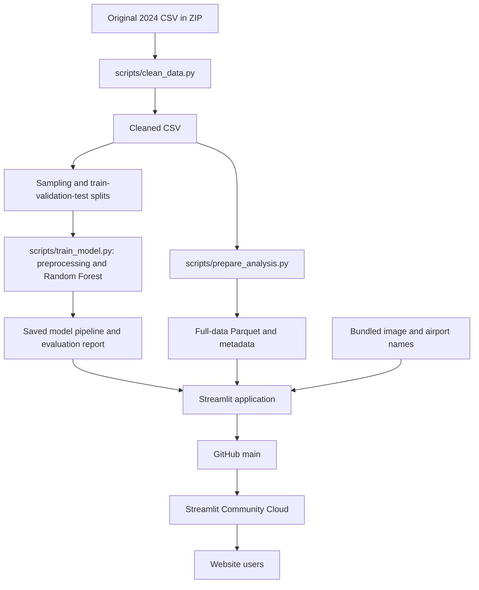

# Aviation Signature — Flight Delay Prediction System

## 1. Project Overview

This Python project estimates flight departure-delay risk using a Random Forest model. A Streamlit website also lets users explore historical flight patterns.

A flight is **delayed when departure is at least 15 minutes late**. The target is `delayed = int(dep_delay >= 15)`. The website's “On Time” label includes early departures and departures less than 15 minutes late.

The website has four pages: Home, Flight Prediction, Flight Analytics, and About. Predictions are historical-data estimates, **not live flight status**.

## 2. Dataset

The project uses US flight data from **January–December 2024**.

| Measure | Records |
|---|---:|
| Original dataset | 7,079,081 |
| Cleaned dataset | 6,982,766 |
| Delayed flights | 1,441,139 |
| Not delayed flights | 5,541,627 |

The full cleaned dataset's delay rate is **20.6385%**. Counts and source hashes are recorded in [the analysis metadata](data/analysis/flight_analysis_2024.metadata.json).

**The original provider, download URL, and dataset license are not recorded.** These still need to be confirmed before distributing the source data.

The original ZIP, cleaned CSV, exploration sample, and data dictionary are local files excluded by `.gitignore`. They are not included in a fresh clone. The website instead includes a compact Parquet table built from the full cleaned dataset: **2,172,103 grouped rows**, about **9.55 MB**. It does not use a sample for analytics.

## 3. Data Cleaning and Preprocessing

The cleaning rules come from `notebooks/02_full_data_analysis.ipynb`:

1. Read the original CSV in 100,000-row chunks.
2. Keep non-cancelled flights: `cancelled == 0`.
3. Exclude flights with missing `dep_delay`.
4. Create `delayed = int(dep_delay >= 15)`.
5. Save the retained columns and target.

Diverted flights and negative delays for early departures remain included. There is no full-data duplicate removal or outlier clipping. Other missing values are preserved during cleaning. Cancelled and missing-delay counts overlap, so they must not be added.

The standalone cleaning script checks required columns, reports missing values and record counts, and refuses to overwrite existing output. From the repository root:

```bash
python scripts/clean_data.py --input data/flight_data_2024.csv.zip --output data/flight_data_cleaned_rebuilt.csv --expected-input-rows 7079081 --expected-output-rows 6982766
```

The ZIP must contain `flight_data_2024.csv`. Plain CSV input is also supported. Run `python scripts/clean_data.py --help` for path options. Use a new output filename for each run.

The model uses these eight features:

| Feature | Meaning |
|---|---|
| `month` | Flight month |
| `day_of_month` | Day of the month |
| `day_of_week` | Monday = 1 through Sunday = 7 |
| `op_unique_carrier` | Operating airline code |
| `origin` | Departure airport code |
| `dest` | Destination airport code |
| `crs_dep_time` | Local scheduled departure time as HHMM, for example 1430 |
| `distance` | Flight distance in miles |

Airline and airport values use most-frequent imputation and one-hot encoding. Numerical features use median imputation. The Random Forest does not use scaling. Preprocessing is fitted only on training data, then applied to validation and test data.

## 4. Project Architecture



Cleaning, training, and analytics preparation run offline. The website loads the saved model and packaged analytics files; it does not retrain the model or need the large original CSVs.

Analytics provides filters, four KPI cards, seven charts (including a weekday-hour heatmap), summary tables, and downloads. Rates are calculated from summed flight counts, not averaged percentages. The average departure delay includes early departures.

## 5. Machine Learning Model

The deployed model is a scikit-learn pipeline saved at `models/flight_delay_rf_model_updated.pkl`. It combines preprocessing with `RandomForestClassifier`.

| Setting | Value |
|---|---|
| Trees (`n_estimators`) | 150 |
| Maximum depth | 25 |
| Minimum samples per leaf | 10 |
| Class weights | `balanced` |
| Random seed | 42 |
| CPU usage (`n_jobs`) | `-1` — all available cores |

The final workflow samples **6% of each time partition within each 100,000-row chunk**, with seed 42. January–September data is split 80/20 into training and validation sets, keeping the class proportions. October–December data is used for testing.

| Split | Records |
|---|---:|
| Training | 250,288 |
| Validation | 62,573 |
| Test | 106,105 |

The standalone script builds a fresh pipeline without intermediate model files or notebook state. It does not run the notebooks' earlier model comparisons or share preprocessing with another model.

The website predicts Delayed at a class-1 probability **≥50%**. Risk levels are Low below 40%, Moderate from 40% to below 70%, and High at 70% or above. Evaluation follows the notebook's `Pipeline.predict`; exact probability ties resolve to class 0, while the website's unchanged rule uses ≥50%.

## 6. Model Results

A full standalone training run reproduced the original test results and confusion matrix **exactly**, using the verified cleaned CSV and environment. It completed in **12.26 seconds**, with no errors. Runtime will vary on other machines.

| Metric | Verified result |
|---|---:|
| Accuracy | 72.563027% |
| Precision | 27.043468% |
| Recall | 37.894440% |
| F1-score | 31.562368% |

Precision, recall, and F1 refer to the delayed class. These results round to the website's 72.56%, 27.04%, 37.89%, and 31.56%.

Confusion matrix (rows: actual; columns: predicted):

| Actual / Predicted | Not delayed | Delayed |
|---|---:|---:|
| Not delayed | 70,280 | 18,110 |
| Delayed | 11,002 | 6,713 |

The difference from the original unrounded metrics was **zero**. Matching evaluation results does not prove byte-identical model files or identical predictions for every possible input. The rebuilt model was saved separately; the deployed model was not replaced.

## 7. Project Structure

```text
Flight_Delay_Prediction/
├── app/
│   ├── app.py                     # Website and prediction interface
│   ├── dashboard_data.py          # Analytics filters and calculations
│   └── airport_labels.py          # Airport display names
├── assets/
│   ├── aviation-hero.jpg
│   ├── airport_names.json
│   └── ATTRIBUTION.md
├── data/analysis/
│   ├── flight_analysis_2024.parquet
│   └── flight_analysis_2024.metadata.json
├── models/
│   └── flight_delay_rf_model_updated.pkl
├── notebooks/
│   ├── 01_data_understanding.ipynb
│   └── 02_full_data_analysis.ipynb
├── scripts/
│   ├── clean_data.py
│   ├── train_model.py
│   └── prepare_analysis.py
├── tests/                         # Python and browser tests
├── .streamlit/config.toml         # Website theme
├── .gitignore
├── requirements.txt
└── README.md
```

Notebook 01 explores a 10,000-row sample; notebook 02 contains the original cleaning and model experiments. Use the standalone scripts for reproduction. The notebooks retain manual path setup and some older outputs; they are not required to run the website.

Photo acknowledgments and licensing are preserved in [assets/ATTRIBUTION.md](assets/ATTRIBUTION.md). Airport-name sources and licensing are recorded in `assets/airport_names.json`. These asset licenses do not cover the flight dataset or project code.

## 8. Installation and How to Run

Use **Python 3.11**; the verified environment used Python **3.11.9**. Runtime and training dependencies are pinned in `requirements.txt`, including Streamlit, pandas, NumPy, scikit-learn, joblib, PyArrow, and Altair.

**Install on macOS:**

```bash
git clone https://github.com/meraahhh/Flight_Delay_Prediction.git
cd Flight_Delay_Prediction
python3.11 -m venv .venv
source .venv/bin/activate
python -m pip install -r requirements.txt
```

**Install on Windows PowerShell:**

```powershell
git clone https://github.com/meraahhh/Flight_Delay_Prediction.git
cd Flight_Delay_Prediction
py -3.11 -m venv .venv
.\.venv\Scripts\Activate.ps1
python -m pip install -r requirements.txt
```

**Run the website** from the repository root:

```bash
python -m streamlit run app/app.py
```

The default local URL is `http://localhost:8501`. A fresh clone contains the model, analytics files, and assets needed to run the website. No API credentials or data preparation are required. If a file is missing, restore it from Git; check dependencies with `python -m pip check`.

**Train a separate model** only when the full cleaned CSV is available. The verified run used this command on macOS:

```bash
.venv/bin/python -B scripts/train_model.py \
  --input data/flight_data_cleaned.csv \
  --output models/flight_delay_rf_model_rebuilt.pkl \
  --report models/flight_delay_rf_model_rebuilt.metrics.json
```

With an activated environment, `python -B` can replace `.venv/bin/python -B`. If using the new cleaning output from section 3, set `--input data/flight_data_cleaned_rebuilt.csv`. Both output paths must be unused. The script protects the deployed model and reports metrics, a confusion matrix, split sizes, source hash, and package versions. Rebuilt outputs are excluded from Git.

**Prepare analytics** separately from the full cleaned CSV:

```bash
python scripts/prepare_analysis.py --source data/flight_data_cleaned.csv --output data/analysis_rebuild --original-zip data/flight_data_2024.csv.zip
```

Use `--source data/flight_data_cleaned_rebuilt.csv` for a newly cleaned file. This creates separate Parquet and metadata files without changing the deployed analytics. The optional `--original-zip` checks the aggregates against the raw source.

**Run the Python tests:**

```bash
python -B -m unittest discover -s tests -v
```

Browser tests require Node.js and Playwright. A separate macOS test setup is:

```bash
npm install --prefix /tmp/flight-browser playwright
PLAYWRIGHT_BROWSERS_PATH=/tmp/flight-browser/browsers /tmp/flight-browser/node_modules/.bin/playwright install --only-shell chromium webkit
export NODE_PATH=/tmp/flight-browser/node_modules
export PLAYWRIGHT_BROWSERS_PATH=/tmp/flight-browser/browsers
```

Start a test server in another terminal with the Python environment active:

```bash
python -m streamlit run app/app.py --server.port 8765 --server.headless true --browser.gatherUsageStats false
```

Telemetry is disabled only for this test server because the offline test blocks external requests. Run the browser scripts sequentially:

```bash
node tests/browser_header.cjs
node tests/browser_analysis.cjs
node tests/browser_website.cjs
node tests/browser_quality.cjs
```

## 9. Live Website

Visit [Aviation Signature](https://meerah-flight-delay-prediction.streamlit.app/).

The site runs on Streamlit Community Cloud, using branch `main` and entrypoint `app/app.py` from [this GitHub repository](https://github.com/meraahhh/Flight_Delay_Prediction). Cloud installs `requirements.txt` and picks up updates from the connected branch. Tests should pass before pushing changes. If the app is asleep, use its wake-up button.

## 10. Limitations

- Data covers historical US flights in 2024, not current worldwide operations. Predictions are not official or live flight status.
- The original dataset source and license still need confirmation. The exploration sample also lacks a generation script.
- Low delayed-class precision and recall mean false alarms and missed delays are common. Accuracy alone is misleading: always predicting Not Delayed would give 83.30% accuracy on the recorded test set.
- Model probabilities are not explicitly calibrated. Risk bands do not guarantee an outcome.
- The form checks that airports differ, but does not verify route existence or calculate distance. Users enter distance in miles.
- Cancelled flights are excluded. The model and analytics do not estimate cancellation risk.
- Analytics shows historical associations, not causes. Small groups need caution; the minimum-flight setting helps limit sparse comparisons.
- Grouped analytics cannot recover individual flights, exact-date filters, medians, or complete delay distributions. Departure hours are local, not a shared timezone.
- Reproduction depends on matching input row order, chunk boundaries, and package versions. The successful run confirms the documented results in the verified environment, not every future environment. The original exploratory notebook does not establish a fully untouched evaluation process.
